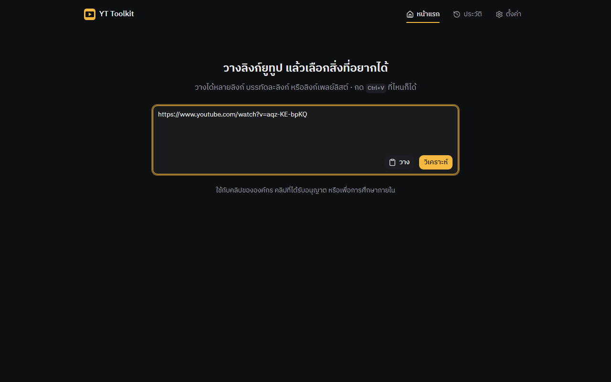
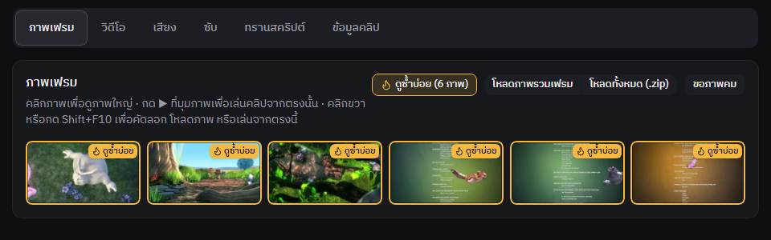
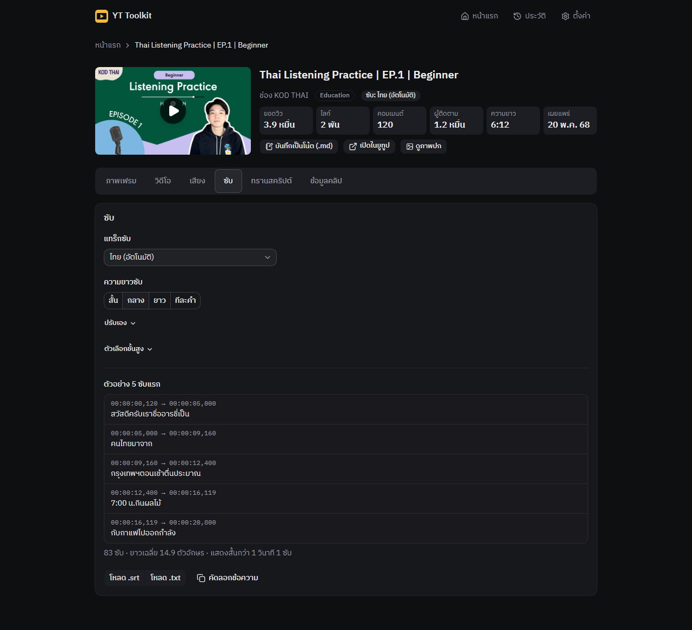
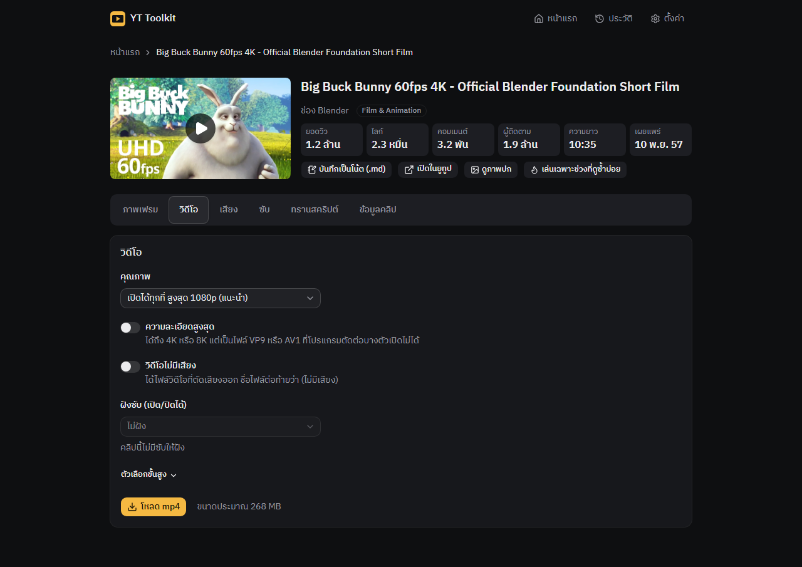
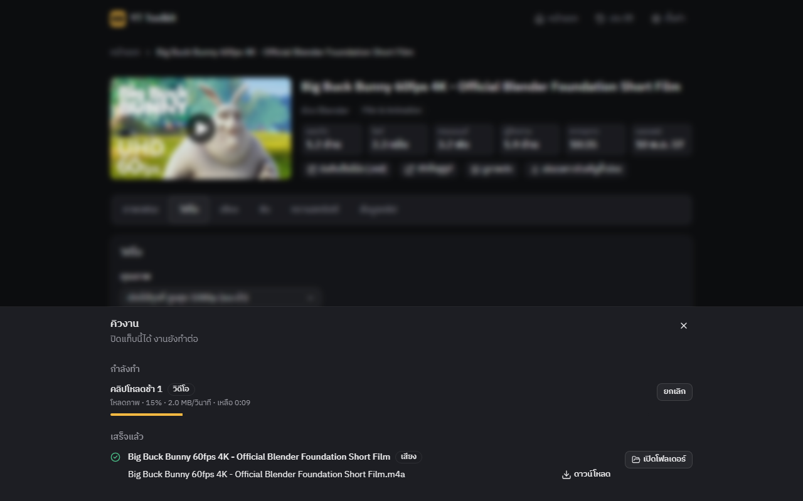
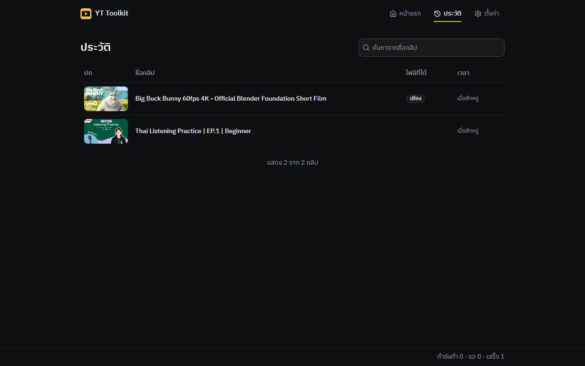
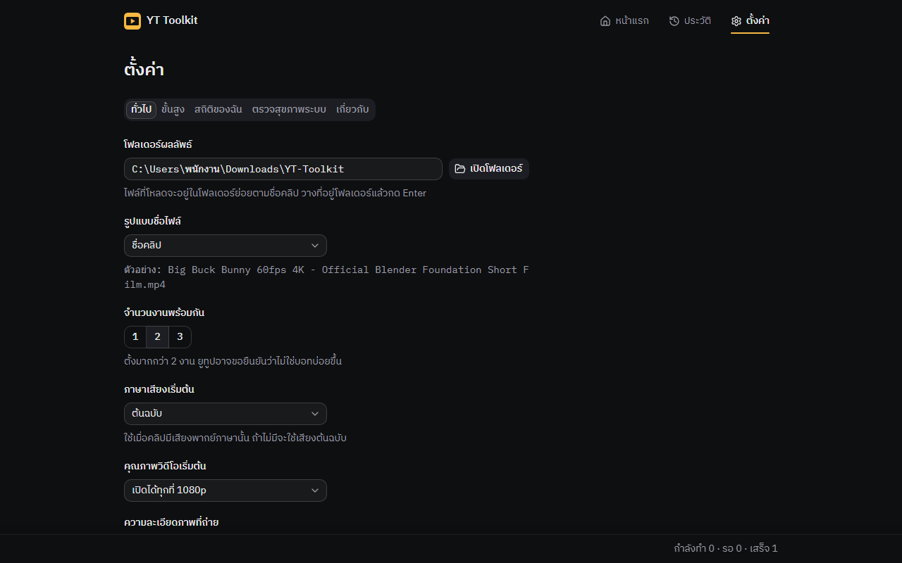

# YT Toolkit

## YT Toolkit คืออะไร

สวัสดีครับเพื่อนๆ YT Toolkit คือโปรแกรมที่ช่วยจัดการคลิปยูทูปบนคอมพิวเตอร์ของคุณเองครับ วางลิงก์ยูทูปลงไป แล้วเลือกได้ว่าจะเอาอะไร จะเป็นวิดีโอ เสียง ซับ (คำบรรยาย) หรือภาพเฟรมจากคลิปก็ได้

โปรแกรมทำงานอยู่ในเครื่องของคุณ ไม่ได้ส่งไฟล์ไปไว้ที่ไหน เปิดผ่านเบราว์เซอร์ที่ `http://127.0.0.1:8787` โดยโปรแกรมเปิดหน้านี้ให้เอง ที่อยู่นี้ใช้ได้เฉพาะบนเครื่องของคุณ เครื่องอื่นเปิดไม่ได้ครับ

ใช้กับยูทูปเท่านั้น และใช้บน Windows ครับ ควรใช้กับคลิปขององค์กร คลิปที่ได้รับอนุญาต หรือเพื่อการศึกษาภายใน ห้ามนำไฟล์ไปเผยแพร่ซ้ำถ้าไม่มีสิทธิ์

## ติดตั้งบน Windows (ทำครั้งเดียว)

ทำตามทีละข้อ ไม่ต้องรู้เรื่องโปรแกรมมิ่งก็ทำได้ครับ

1. **ลง Git** Git คือโปรแกรมที่ใช้ดึงตัวโปรแกรมมาไว้ในเครื่อง และใช้อัปเดตให้ทีหลัง เปิด PowerShell (กดปุ่ม Windows แล้วพิมพ์ PowerShell) แล้ววางคำสั่งนี้ กด Enter

   ```powershell
   winget install Git.Git
   ```

   ถ้ามีข้อความถามให้ยอมรับเงื่อนไข ให้พิมพ์ Y แล้วกด Enter และถ้า Windows ขึ้นหน้าต่างขออนุญาตติดตั้ง ให้กด Yes ครับ รอจนติดตั้งเสร็จ

   **สำคัญ:** พอติดตั้งเสร็จ ให้ปิดหน้าต่าง PowerShell แล้วเปิดใหม่อีกครั้งก่อนไปข้อ 3 ครับ ถ้าใช้หน้าต่างเดิม คำสั่งในข้อ 3 จะขึ้นว่าไม่รู้จัก git

2. **รับคำเชิญเข้า repo นี้ที่ GitHub** repo คือที่เก็บตัวโปรแกรม คุณจะได้อีเมลคำเชิญ กดยอมรับในอีเมลหรือที่หน้าเว็บ GitHub ครับ ถ้ายังไม่ได้รับคำเชิญ ให้แจ้งผู้ดูแล

3. **ดึงตัวโปรแกรมมาไว้ในเครื่อง** ในหน้าต่าง PowerShell ที่เพิ่งเปิดใหม่ วางคำสั่งนี้ ครั้งแรกจะมีหน้าต่างเบราว์เซอร์เด้งขึ้นมาให้ล็อกอิน GitHub ล็อกอินให้เสร็จแล้วรอสักครู่ครับ

   ```powershell
   git clone https://github.com/ta-ai-pakorn/yt-toolkit.git "$env:USERPROFILE\YT-Toolkit"
   ```

   คำสั่งนี้จะสร้างโฟลเดอร์ชื่อ `YT-Toolkit` ในโฟลเดอร์ผู้ใช้ของคุณ

4. **เปิดโปรแกรม** เปิดโฟลเดอร์ `YT-Toolkit` แล้วดับเบิลคลิกไฟล์ `start.bat`

### ครั้งแรกที่เปิดจะเป็นยังไง

จะมีหน้าต่างสีดำขึ้นมา ข้อความวิ่งเป็นขั้น ๆ ครับ ไม่ต้องกดอะไร แค่รอ

- `[1/4]` ตรวจว่ามีเวอร์ชันใหม่ไหม ถ้ามีจะอัปเดตให้เอง
- `[2/4]` ตรวจว่ามีเครื่องมือเตรียมโปรแกรมอยู่ในเครื่องหรือยัง ถ้ายังไม่มีจะติดตั้งให้
- `[3/4]` เตรียมส่วนประกอบที่โปรแกรมต้องใช้ ขั้นนี้ครั้งแรกนานที่สุด
- `[4/4]` เปิด YT Toolkit

ครั้งแรกอาจใช้เวลาได้ถึง 10 นาที ขึ้นกับความเร็วอินเทอร์เน็ต อย่าเพิ่งปิดหน้าต่างสีดำนะครับ พอพร้อมแล้ว **เบราว์เซอร์จะเปิดหน้าโปรแกรมขึ้นมาเอง** หน้าต่างสีดำจะปิดตัวเอง และจะมีไอคอนสีอำพันของโปรแกรมที่มุมขวาล่างของจอ

ครั้งต่อไปเร็วกว่ามากครับ

ถ้าขึ้นว่า "เปิดโปรแกรมไม่สำเร็จ" ให้ถ่ายภาพหน้าจอหน้าต่างสีดำนั้นส่งให้ผู้ดูแล แล้วกดปุ่มใดก็ได้เพื่อปิดหน้าต่าง

## เปิด ปิด และอัปเดต

- **เปิด:** ดับเบิลคลิก `start.bat` ทุกครั้งที่อยากใช้
- **ปิด:** ดับเบิลคลิก `stop.bat` หรือคลิกขวาไอคอนสีอำพันที่มุมขวาล่าง แล้วเลือก “ปิดโปรแกรม” หรือจะกดปุ่ม “ปิดโปรแกรม” ในหน้าตั้งค่า แท็บ “ตรวจสุขภาพระบบ” ก็ได้ครับ
  (บน Windows 11 ถ้าไม่เห็นไอคอน ให้กดลูกศร `^` ที่มุมขวาล่างของแถบงาน ไอคอนอาจซ่อนอยู่ในนั้น)
- **อัปเดต: ปิดแล้วเปิดใหม่ = ได้เวอร์ชันล่าสุดครับ** ไม่มีปุ่มอัปเดตในโปรแกรมและไม่ต้องทำอะไรเพิ่ม เพราะ `start.bat` ตรวจและอัปเดตให้ทุกครั้งที่ดับเบิลคลิก ถ้าโปรแกรมเปิดค้างอยู่ตอนนั้น หน้าต่างสีดำจะบอกให้ปิดแล้วเปิดใหม่

## ใช้งานคร่าว ๆ

ภาพในคู่มือนี้เป็นข้อมูลตัวอย่างครับ หน้าตาในเครื่องคุณจะมีคลิปของคุณเอง

### 1. วางลิงก์

หน้าแรกมีช่องใหญ่ให้วางลิงก์ยูทูป วางได้หลายลิงก์ บรรทัดละลิงก์ หรือวางลิงก์เพลย์ลิสต์ก็ได้ แล้วกดปุ่ม “วิเคราะห์” ครับ



### 2. หน้าคลิป: ภาพเฟรม

กดวิเคราะห์ลิงก์เดียวแล้วจะเข้าหน้าของคลิปนั้น ด้านบนมีชื่อคลิปและตัวเลขสำคัญ ด้านล่างเป็นแท็บเครื่องมือ: “ภาพเฟรม” “วิดีโอ” “เสียง” “ซับ” “ทรานสคริปต์” และ “ข้อมูลคลิป”

แท็บ “ภาพเฟรม” แสดงภาพตัวอย่างจากทุกช่วงของคลิป เลือกภาพที่ต้องการแล้วโหลดทีละภาพ หรือกด “โหลดภาพรวมเฟรม” เพื่อได้ภาพรวมเป็นแผ่นเดียว หรือ “โหลดทั้งหมด (.zip)” เพื่อได้ทุกภาพในไฟล์เดียว ถ้าอยากได้ภาพที่คมกว่า กด “ขอภาพคม” ครับ (ในรูปด้านล่างกดตัวกรองดูซ้ำบ่อยไว้ จึงเห็นแค่บางภาพ)



### 3. หน้าคลิป: ซับ

แท็บ “ซับ” ให้เลือกแทร็กซับ และเลือกความยาวของซับได้ด้วยปุ่ม “สั้น” “กลาง” “ยาว” “ทีละคำ” มีตัวอย่าง 5 ซับแรกให้ดูก่อน ถูกใจแล้วกด “โหลด .srt” หรือ “โหลด .txt” หรือ “คัดลอกข้อความ” ครับ



### 4. โหลดวิดีโอหรือเสียง

แท็บ “วิดีโอ” เลือกคุณภาพแล้วกด “โหลด mp4” ส่วนแท็บ “เสียง” เลือกรูปแบบไฟล์ (m4a, mp3 หรือ wav) แล้วกดปุ่มโหลดที่ตามด้วยชื่อรูปแบบนั้น กดแล้วงานจะเข้าคิว ไม่ต้องรอหน้าจอครับ



### 5. คิวงาน

งานที่กดโหลดจะไปรอที่แถบด้านล่างของจอ ซึ่งบอกว่า กำลังทำ · รอ · เสร็จ อย่างละกี่งาน กดแถบนั้นจะเปิดรายการ “คิวงาน” ขึ้นมา: งานที่ “กำลังทำ” พร้อมความคืบหน้า และงานที่ “เสร็จแล้ว” กด “ยกเลิก” ได้ถ้าเปลี่ยนใจ กด “เปิดโฟลเดอร์” เพื่อไปดูไฟล์ หรือ “ดาวน์โหลด” เพื่อเอาไฟล์ผ่านเบราว์เซอร์ ปิดแท็บเบราว์เซอร์ได้เลย งานยังทำต่อครับ



### 6. ประวัติ

เมนู “ประวัติ” ที่มุมขวาบนเก็บคลิปทั้งหมดที่คุณเคยเปิด พร้อมป้ายบอกว่าโหลดอะไรไปแล้ว ค้นหาจากชื่อคลิปได้ กดชื่อคลิปเพื่อกลับไปหน้าของคลิปนั้น ไม่ต้องวางลิงก์ใหม่ครับ



### 7. ตั้งค่า

เมนู “ตั้งค่า” มีแท็บ “ทั่วไป” “ขั้นสูง” “สถิติของฉัน” “ตรวจสุขภาพระบบ” และ “เกี่ยวกับ” ที่ใช้บ่อยคือแท็บ “ทั่วไป” ซึ่งเปลี่ยน “โฟลเดอร์ผลลัพธ์” (ที่เก็บไฟล์ที่โหลด) ได้ และมีปุ่ม “สำรองค่าตั้ง” กับ “นำเข้าค่าตั้ง” ด้วยครับ



## ไฟล์ที่โหลดไปอยู่ที่ไหน

- ไฟล์ทั้งหมดลงที่ `Downloads\YT-Toolkit\<ชื่อคลิป> [<id>]\` ซึ่งเป็นโฟลเดอร์ Downloads ของ Windows ที่คุณใช้อยู่ คลิปเดียวมีโฟลเดอร์เดียว ทั้งวิดีโอ เสียง ซับ และภาพเฟรมของคลิปนั้นอยู่รวมกัน ชื่อซ้ำไม่เขียนทับ โปรแกรมต่อท้ายว่า `(2)` ให้เองครับ
- ในโฟลเดอร์มีไฟล์ `แหล่งที่มา.txt` บอกชื่อคลิป ช่อง ลิงก์ วันที่ และสัญญาอนุญาต พร้อมบรรทัดเครดิตที่คัดลอกไปใส่สไลด์ได้เลย (ปุ่ม “คัดลอกเครดิต” ในแท็บ “ข้อมูลคลิป” ให้บรรทัดเดียวกัน)
- อยากเปลี่ยนที่เก็บ: ตั้งค่า แท็บ “ทั่วไป” ช่อง “โฟลเดอร์ผลลัพธ์” วางที่อยู่โฟลเดอร์แล้วกด Enter ส่วนปุ่ม “เปิดโฟลเดอร์” ในรายการ “คิวงาน” จะเปิด Explorer พร้อมเลือกไฟล์ให้
- มีสองอย่างที่ไม่ลงโฟลเดอร์นี้ คือปุ่ม “โหลดภาพนี้” ของภาพเฟรมเดียว กับ “บันทึกเป็นโน้ต (.md)” สองอย่างนี้โหลดผ่านเบราว์เซอร์ ไฟล์จึงไปอยู่ในโฟลเดอร์ Downloads ของเบราว์เซอร์ครับ

## คลิปที่ต้องใช้บัญชียูทูป (จำกัดอายุ หรือส่วนตัว)

คลิปบางประเภทยูทูปไม่ให้ดูถ้าไม่ได้ล็อกอิน เช่น คลิปจำกัดอายุ และคลิปส่วนตัว โปรแกรมจะบอกเมื่อเจอแบบนี้ และมีปุ่ม “ใช้บัญชียูทูปชั่วคราว” ให้กด (ปุ่มเดียวกันอยู่ที่ ตั้งค่า แท็บ “ขั้นสูง” ด้วย) โปรแกรมจะขอไฟล์ชื่อ `cookies.txt` ครับ ไฟล์นี้คือตัวที่บอกยูทูปว่า "คนนี้ล็อกอินแล้ว"

**ข้อควรระวัง:** ใช้ **บัญชีสำรอง** เท่านั้น ห้ามใช้บัญชีเจ้าของช่องหรือบัญชีงานหลัก เพราะบัญชีที่ใช้อาจถูกยูทูปจำกัดหรือถูกล็อกได้ และกระทบ Gmail กับ Drive ของบัญชีนั้นด้วย และห้ามส่งไฟล์ `cookies.txt` ให้ใครครับ

### วิธีทำไฟล์ cookies.txt

1. เปิดหน้าต่าง **ไม่ระบุตัวตน** (private/incognito) ของเบราว์เซอร์ ใน Chrome และ Edge กด Ctrl+Shift+N
2. ในหน้าต่างนั้น เข้าสู่ระบบยูทูปด้วยบัญชีสำรอง
3. เปิดที่อยู่ `youtube.com/robots.txt` ในแท็บเดิม (แท็บที่เพิ่งล็อกอิน ไม่ต้องเปิดแท็บใหม่)
4. ส่งออกไฟล์ `cookies.txt` ด้วยส่วนขยาย (extension) ของเบราว์เซอร์ที่ทำหน้าที่ส่งออกไฟล์นี้ ต้องตั้งให้ส่วนขยายทำงานในหน้าต่างไม่ระบุตัวตนได้ด้วย ถ้าไม่แน่ใจว่าใช้ตัวไหน ให้ถามผู้ดูแล
5. เปิดหน้าต่างไม่ระบุตัวตนนั้นค้างไว้ก่อน อย่าเปิดยูทูปในหน้าต่างนั้นอีก
6. กลับมาที่โปรแกรม กดเลือกไฟล์ `cookies.txt` ที่เพิ่งส่งออก แล้วกด “นำเข้าแล้วลองใหม่” (หรือ “นำเข้า”)
7. ถ้าเป็นคลิปส่วนตัว ต้องให้เจ้าของช่องแชร์คลิปให้อีเมลของบัญชีสำรองใน YouTube Studio ก่อนครับ

### ทำไมต้องใช้หน้าต่างไม่ระบุตัวตน

ยูทูปจะเปลี่ยนตัวยืนยันการล็อกอินเรื่อย ๆ ขณะที่เบราว์เซอร์ใช้งานยูทูปอยู่ ถ้าส่งออกไฟล์จากเบราว์เซอร์ปกติ ไฟล์จะ **หมดอายุเร็ว** เพราะเบราว์เซอร์ไปเปลี่ยนตัวยืนยันนั้นแล้ว โปรแกรมจะโหลดคลิปไม่ได้ และคุณจะนึกว่าโปรแกรมเสีย ทั้งที่ไม่ใช่ครับ หน้าต่างไม่ระบุตัวตนที่เปิดค้างไว้ไม่ได้ใช้ยูทูปต่อ ตัวยืนยันจึงไม่ถูกเปลี่ยน ไฟล์จึงใช้ได้นานกว่า และยังไม่ปนกับเบราว์เซอร์ส่วนตัวของคุณด้วย

### เสร็จแล้วทำอะไรต่อ

โปรแกรมเก็บการล็อกอินนี้ไว้ชั่วคราว และลบเองเมื่อโหลดเสร็จ มีข้อความบอกเวลาที่จะลบอัตโนมัติ อยากลบทันทีกด “ลบออกตอนนี้” ได้ หลังจากนั้นกลับไปที่หน้าต่างไม่ระบุตัวตน กดออกจากระบบ แล้วปิดหน้าต่างนั้นครับ

## เจอปัญหาทำยังไง

1. เปิด ตั้งค่า แล้วเลือกแท็บ “ตรวจสุขภาพระบบ” จะมีรายการของที่โปรแกรมต้องใช้ แต่ละแถวบอกสถานะ “พร้อม” “เตือน” หรือ “ใช้ไม่ได้” กด “ตรวจอีกครั้ง” เพื่อเช็กใหม่ ถ้าแถวไหนขึ้นเตือนหรือใช้ไม่ได้ ข้อความในแถวนั้นจะบอกว่าเป็นเรื่องอะไรครับ หน้านี้มีปุ่ม “คัดลอกข้อมูลแจ้งปัญหา” ของตัวเองด้วย กดแล้วส่งให้ผู้ดูแลได้เลย แม้ยังไม่มีข้อความผิดพลาดขึ้น
2. เมื่อโปรแกรมขึ้นข้อความผิดพลาด ให้กด “ดูรายละเอียด” แล้วกดปุ่ม “คัดลอกข้อมูลแจ้งปัญหา” โปรแกรมจะคัดลอกข้อมูลที่ผู้ดูแลต้องใช้ให้ ไม่ต้องถ่ายภาพหน้าจอ
3. วางข้อความที่คัดลอกลงในแชตหรืออีเมล ส่งให้ผู้ดูแลระบบ พร้อมเล่าสั้น ๆ ว่ากำลังทำอะไรอยู่ตอนนั้นครับ

ถ้าเปิดโปรแกรมไม่ขึ้นเลย ให้ถ่ายภาพหน้าต่างสีดำของ `start.bat` ส่งให้ผู้ดูแลครับ

---

สำหรับผู้พัฒนา: [docs/development.md](docs/development.md)
